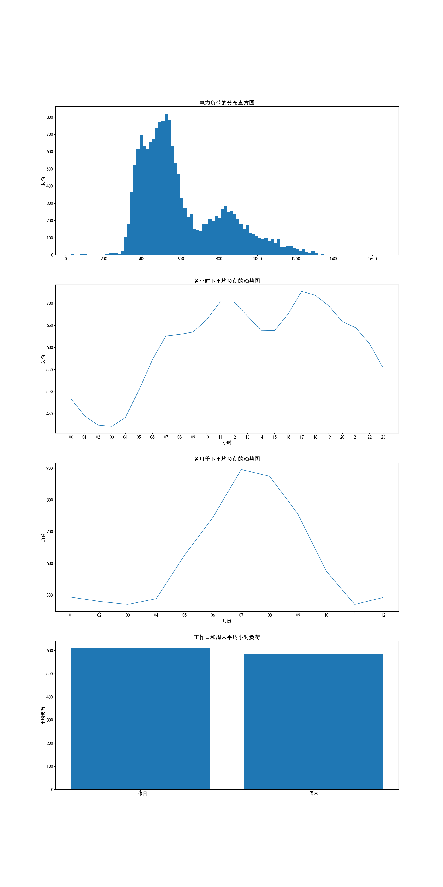
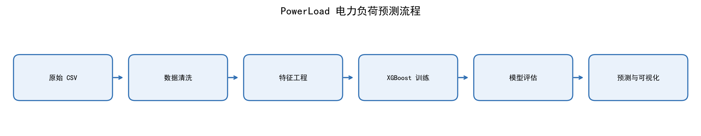
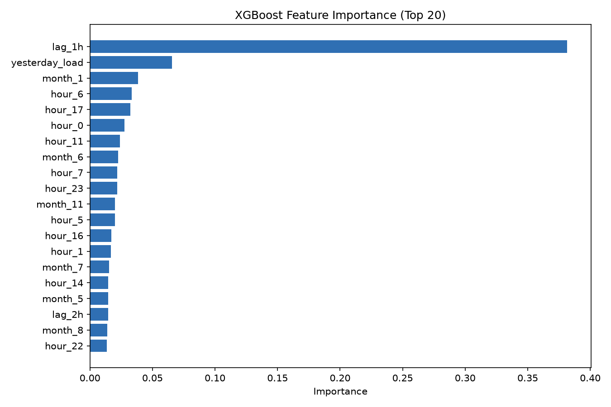
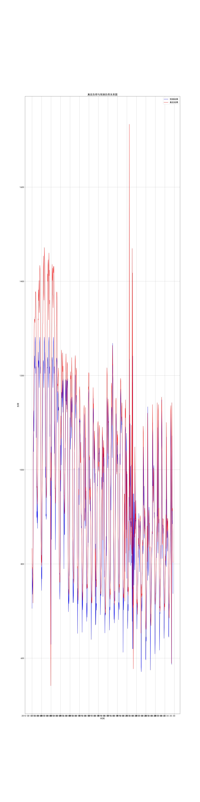
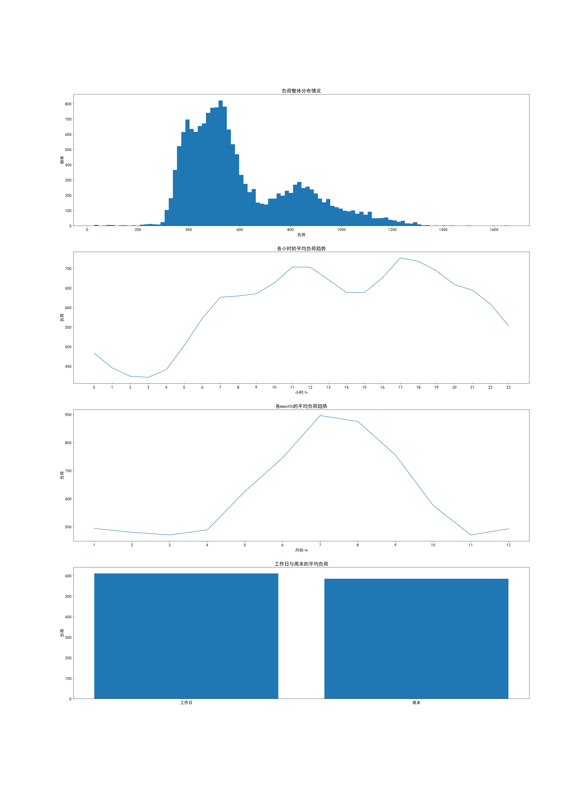

# 电力负荷预测（XGBoost）

基于历史小时级电力负荷数据的短期预测项目，使用 XGBoost 完成数据清洗、特征工程、模型训练、误差评估、预测和可视化。

## 项目概览

| 项目信息 | 内容 |
| --- | --- |
| 任务类型 | 单步短期电力负荷预测 |
| 数据规模 | 训练集 16,752 条，测试集 768 条 |
| 输入特征 | 40 维：24 个小时特征 + 12 个月份特征 + 4 个滞后特征 |
| 模型 | XGBRegressor |
| 主要指标 | R² 0.8589，RMSE 79.43，MAE 46.15，MAPE 7.56% |
| 运行入口 | src/train.py、src/predict.py |

## 目录

1. [项目背景](#项目背景)
2. [数据说明](#数据说明)
3. [数据探索](#数据探索)
4. [方法与特征工程](#方法与特征工程)
5. [特征重要性](#特征重要性)
6. [实验结果](#实验结果)
7. [环境要求](#环境要求)
8. [安装](#安装)
9. [快速开始](#快速开始)
10. [项目结构](#项目结构)
11. [常见问题](#常见问题)

## 项目背景

电力负荷预测是电网调度、机组组合和需求侧管理的基础环节。准确的短期负荷预测可以帮助运行人员提前安排发电计划、降低备用成本，并为异常负荷波动提供预警依据。

本项目使用历史逐小时负荷数据，通过构造时间特征和滞后特征建立 XGBoost 回归模型，对未来时刻的电力负荷进行单步预测。项目保留原始课程项目的训练和预测逻辑，重点补充了可复现说明、评估指标和结果展示。

## 数据说明

| 数据集 | 时间范围 | 样本数 | 字段 |
| --- | --- | ---: | --- |
| data/train.csv | 2013-10-01 至 2015-07-09 | 16,752 | time, power_load |
| data/test.csv | 2015-07-31 至 2015-08-09 | 768 | time, power_load |

字段说明：

- **time**：小时级时间戳，例如 2013/9/2 0:00。
- **power_load**：对应时刻的电力负荷值，单位为原始数据提供的负荷单位。

数据预处理包括时间解析、排序、去重和缺失值过滤。训练集与测试集按 8:2 随机划分，随机种子为 0。

## 数据探索

从整体分布可以看到明显的日周期和季节波动：

- 一天内存在早晚两个负荷高峰；
- 夏季和冬季负荷高于过渡季节；
- 相邻小时负荷具有较强连续性，适合引入滞后特征；
- 极端负荷值较少，但仍需在训练时关注误差分布。

## 方法与特征工程

### 特征设计

| 特征组 | 具体特征 | 说明 |
| --- | --- | --- |
| 小时特征 | hour_0 ~ hour_23 | 24 维 one-hot，捕捉日内负荷周期 |
| 月份特征 | month_1 ~ month_12 | 12 维 one-hot，捕捉季节变化 |
| 短期滞后 | 前1小时 / 前2小时 / 前3小时 | 相邻时刻负荷惯性 |
| 日周期特征 | yesterday_load | 昨日同时刻负荷 |

### 模型参数

| 参数 | 取值 |
| --- | --- |
| 模型 | XGBRegressor |
| n_estimators | 500 |
| max_depth | 6 |
| learning_rate | 0.03 |
| objective | reg:squarederror |
| n_jobs | -4 |
| random_state | 0（数据划分） |

### 处理流程

训练流程为：

1. 读取 train.csv 并解析 time 字段；
2. 提取小时、月份 one-hot 特征；
3. 生成前 1/2/3 小时负荷和昨日同时刻负荷；
4. 按 8:2 划分训练集和测试集；
5. 训练 XGBRegressor；
6. 在测试集计算 MSE、RMSE、MAE、MAPE 和 R²；
7. 保存模型到 model/，保存训练日志到 log/，预测结果输出到 reports/figures/。

## 特征重要性

特征重要性显示，昨日同时刻负荷和前 1—3 小时负荷是模型最主要的预测依据，小时 one-hot 特征次之，月份特征主要起到季节性修正作用。

## 实验结果

### 指标

| 指标 | 数值 |
| --- | ---: |
| R² | 0.8589 |
| MSE | 6309.49 |
| RMSE | 79.43 |
| MAE | 46.15 |
| MAPE | 7.56% |

### 预测对比

在测试集单独预测时，MAE 约为 68.99，说明模型在更靠后的时间段上仍保持可用预测能力。

### 负荷分布

预测曲线整体贴合真实负荷，主要误差集中在负荷快速变化的早晚高峰附近。

## 环境要求

- Python 3.10+
- pandas、numpy、matplotlib、scikit-learn、xgboost、joblib
- 依赖版本见 requirements.txt

## 安装

~~~bash
git clone https://github.com/Smasun0721/power-load-forecasting.git
cd power-load-forecasting
python -m venv .venv

# Windows
.venv\Scripts\activate

# macOS / Linux
source .venv/bin/activate

pip install -r requirements.txt
~~~

## 快速开始

训练和预测脚本使用相对路径，需要从 src 目录运行，并让项目根目录进入 PYTHONPATH。

Windows PowerShell：

~~~powershell
cd src
$env:PYTHONPATH = ".."
python train.py
python predict.py
~~~

macOS / Linux：

~~~bash
cd src
export PYTHONPATH=..
python train.py
python predict.py
~~~

默认只保存图片，不弹出窗口；设置 SHOW_PLOTS=1 可以打开绘图窗口。

## 项目结构

~~~text
power-load-forecasting/
├── data/
│   ├── train.csv
│   ├── test.csv
│   └── fig/
├── log/                   # 原始训练/预测日志
├── model/                 # 已训练模型
├── reports/figures/       # README 使用的图片
├── src/
│   ├── train.py
│   └── predict.py
├── utils/
│   ├── common.py
│   └── log.py
├── docs/architecture.png
├── requirements.txt
└── README.md
~~~

## 可复现性说明

- 原始训练脚本入口为 src/train.py，输出模型到 model/，日志到 log/。
- 原始预测脚本入口为 src/predict.py，默认加载 model/xgb_20260919-205459.pkl。
- 训练日志 train_20260917.log、train_20260918.log、train_20260919.log 已随仓库保留，便于核对训练过程。
- 数据授权请以原始课程或数据提供方为准。

## 常见问题

**Q：运行时提示找不到 utils 或 src 模块？**  
请确认从 src 目录运行，并将项目根目录加入 PYTHONPATH。

**Q：为什么没有弹出 matplotlib 窗口？**  
默认只保存图片；设置 SHOW_PLOTS=1 可打开窗口。

**Q：预测脚本报模型文件不存在？**  
先在 model/ 目录放入训练生成的 pkl 文件，或修改 src/predict.py 中的模型文件名。

## 后续优化

- 采用时间序列交叉验证和滚动预测，避免随机切分造成信息泄漏。
- 加入温度、天气、节假日等外部特征，提高特殊日期预测精度。
- 对比 LightGBM、CatBoost、LSTM、Temporal Fusion Transformer 等模型。
- 将训练和预测封装为 CLI 或 FastAPI 服务，接入实时数据流。
